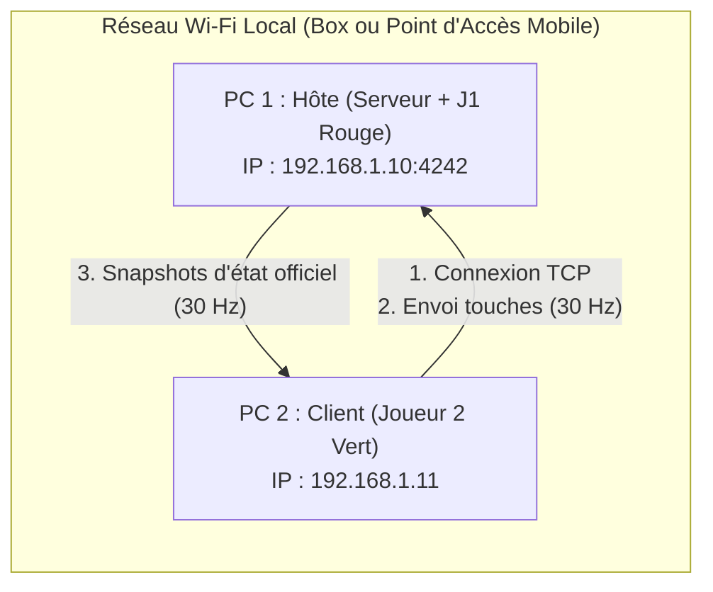
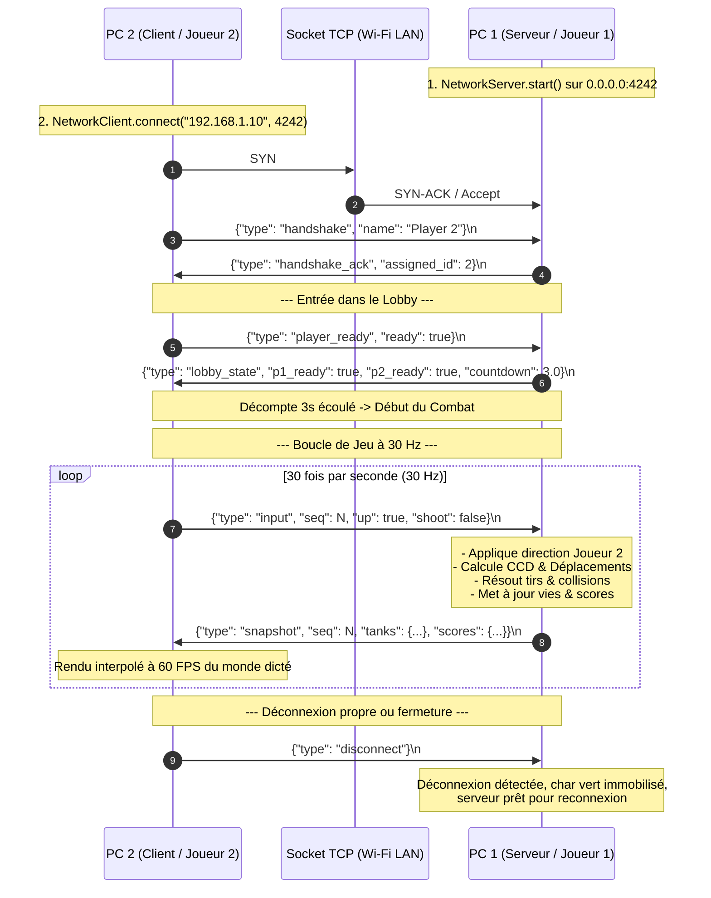

# 🌐 Guide Réseau Multijoueur LAN Wi-Fi — TANK WAR (Arena Duel)

Ce guide est un **tutoriel pratique et technique complet** permettant à deux joueurs de s'affronter depuis deux ordinateurs distincts (PC portables ou fixes) connectés au même réseau Wi-Fi local, **sans aucune dépendance à Internet**.

---

## 1. 📋 Prérequis et Principes Fondamentaux

1. **Deux ordinateurs** (Windows 10/11, Linux ou macOS).
2. **Python 3.12 ou supérieur** installé sur les deux machines.
3. Les deux machines doivent être connectées au **même réseau local** :
   - Soit sur la même Box Internet / Routeur Wi-Fi domestique.
   - Soit sur un **Partage de connexion (Point d'accès mobile 4G/5G)** activé sur un smartphone ou depuis l'un des deux PC (aucune donnée Internet n'est consommée).
4. **Port TCP utilisé** :
   - Par défaut : **`4242`**.
   - Configurable à volonté via l'option `--port <PORT>` ou directement dans le champ de saisie (`IP:PORT`).

---

## 2. 🚀 Tutoriel Pratique Étape par Étape



---

### 2.1 Ordinateur 1 : L'Hôte (Serveur Autoritaire + Joueur 1 Rouge)

L'Ordinateur 1 héberge le serveur TCP faisant autorité sur la physique, les collisions et l'arbitrage, tout en permettant au Joueur 1 de piloter le char rouge.

#### Étape 1 : Se connecter au réseau Wi-Fi
Connectez le PC 1 à votre réseau Wi-Fi local (Box ou point d'accès smartphone).

#### Étape 2 : Préparer le projet et les dépendances
Ouvrez un terminal (PowerShell sous Windows) dans le dossier du jeu :
```powershell
# 1. Créer l'environnement virtuel (si pas encore fait)
python -m venv .venv

# 2. Activer l'environnement
.\.venv\Scripts\Activate.ps1

# 3. Installer les dépendances
pip install -r requirements.txt
```

#### Étape 3 : Identifier votre adresse IPv4 locale
Dans PowerShell, exécutez la commande :
```powershell
ipconfig
```
Repérez la section correspondant à votre carte sans fil :
```text
Carte réseau sans fil Wi-Fi :
   Suffixe DNS propre à la connexion. . . : home
   Adresse IPv4. . . . . . . . . . . . . .: 192.168.1.10
   Masque de sous-réseau . . . . . . . . .: 255.255.255.0
   Passerelle par défaut . . . . . . . . .: 192.168.1.1
```
> 📌 **Note** : Notez bien l'adresse IPv4 (dans cet exemple : `192.168.1.10`). C'est cette adresse que vous communiquerez au Joueur 2.

#### Étape 4 : Lancer le jeu en mode Hôte
Deux possibilités au choix :
- **Via l'interface graphique** :
  ```powershell
  python main.py
  ```
  Puis cliquez sur le bouton **`📡 HÉBERGER UNE PARTIE`**. L'écran d'attente s'ouvre, démarre le serveur TCP et affiche automatiquement votre adresse IP locale en grand format.
- **Directement en ligne de commande** :
  ```powershell
  python main.py --host
  ```
  *(Pour utiliser un port spécifique, par exemple 5555 : `python main.py --host --port 5555`).*

#### Étape 5 : Attendre la connexion du Joueur 2
Un indicateur radar clignote : *"En attente de connexion du Joueur 2..."*. Dès que le Joueur 2 se connecte, l'écran bascule automatiquement vers le **Lobby du combat**.

#### Étape 6 : Démarrer la partie
Dans le lobby, cliquez sur **`✅ JE SUIS PRÊT`** (ou appuyez sur `ESPACE`). Dès que les deux joueurs sont prêts, un compte à rebours de **3 secondes** se déclenche et le duel commence !

---

### 2.2 Ordinateur 2 : Le Client (Joueur 2 Vert Distant)

L'Ordinateur 2 se connecte au PC 1, échantillonne les commandes clavier du Joueur 2 et affiche l'état du monde dicté par le serveur.

#### Étape 1 : Se connecter au même réseau Wi-Fi
Connectez impérativement le PC 2 au **même réseau Wi-Fi** que le PC 1.

#### Étape 2 : Préparer le projet et les dépendances
Ouvrez PowerShell dans le dossier du jeu :
```powershell
.\.venv\Scripts\Activate.ps1
pip install -r requirements.txt
```

#### Étape 3 : Lancer le jeu et rejoindre l'hôte
Deux possibilités au choix :
- **Via l'interface graphique** :
  ```powershell
  python main.py
  ```
  1. Cliquez sur **`🔗 REJOINDRE UNE PARTIE`**.
  2. Saisissez l'adresse IP de l'hôte (ex: `192.168.1.10` ou `192.168.1.10:4242`).
  3. Cliquez sur **`SE CONNECTER`** (ou appuyez sur `Entrée`).
  4. La connexion s'établit en arrière-plan sans bloquer l'écran, et bascule vers le **Lobby**.
- **Directement en ligne de commande** :
  ```powershell
  python main.py --join 192.168.1.10
  ```
  *(Ou avec un port personnalisé : `python main.py --join 192.168.1.10:5555`).*

#### Étape 4 : Confirmer sa préparation
Dans le salon d'attente, cliquez sur **`✅ JE SUIS PRÊT`** (ou appuyez sur `ESPACE`). Dès que le compte à rebours se termine, prenez le contrôle du char vert avec les **Flèches directionnelles** et **Entrée** pour tirer !

---

## 3. 💡 Exemple Concret de Déploiement

Imaginons une partie entre Alice et Bob dans la même pièce :

| Paramètre | Ordinateur 1 (Alice) | Ordinateur 2 (Bob) |
| :--- | :--- | :--- |
| **Rôle** | **Hôte** (Serveur TCP + Joueur 1 Rouge) | **Client** (Joueur 2 Vert) |
| **Adresse IP Wi-Fi réelle** | `192.168.1.10` | `192.168.1.11` |
| **Port TCP utilisé** | `4242` *(ou `5555` selon votre choix)* | — |
| **Commande de lancement** | `python main.py --host` | `python main.py --join 192.168.1.10` |
| **Contrôles clavier** | `ZQSD` pour bouger, `ESPACE` pour tirer | `Flèches` pour bouger, `ENTRÉE` pour tirer |

> ⚠️ **Rappel important** : Les adresses `192.168.1.10` et `192.168.1.11` sont des exemples. Vous devez impérativement renseigner l'adresse IP affichée par votre commande `ipconfig` ou sur l'écran d'hébergement du jeu.

---

## 4. 🛡️ Configuration du Pare-Feu Windows (Windows Defender Firewall)

Le pare-feu Windows bloque par défaut les connexions TCP entrantes non enregistrées pour protéger votre ordinateur. Si le Joueur 2 ne parvient pas à se connecter au PC 1, le pare-feu en est la cause dans 95% des cas.

### 4.1 Pourquoi Windows Firewall bloque-t-il la socket ?
Le PC 1 agit comme un serveur en ouvrant un port en écoute (`0.0.0.0:4242`). Lorsque le PC 2 envoie son paquet de connexion TCP SYN, le pare-feu du PC 1 l'intercepte et le rejette silencieusement s'il n'existe aucune règle autorisant explicitement le trafic sur ce port.

### 4.2 Autoriser le port TCP du jeu en une commande PowerShell
Sur l'**Ordinateur 1 (Hôte)** :
1. Faites un clic droit sur le menu Démarrer de Windows et choisissez **Terminal (Administrateur)** ou **Windows PowerShell (Administrateur)**.
2. Copiez-collez la commande suivante et appuyez sur `Entrée` :

```powershell
New-NetFirewallRule -DisplayName "Tank War LAN 4242" -Direction Inbound -LocalPort 4242 -Protocol TCP -Action Allow -Profile Private
```

#### Explication détaillée des paramètres de la commande :
- `-DisplayName "Tank War LAN 4242"` : Nom clair de la règle affiché dans la console de gestion du pare-feu.
- `-Direction Inbound` : Règle entrante (autorise les paquets venant de l'extérieur vers ce PC).
- `-LocalPort 4242` : Numéro de port TCP utilisé par le jeu (si vous utilisez le port 5555, indiquez `-LocalPort 5555`).
- `-Protocol TCP` : Protocole de transport utilisé par le jeu.
- `-Action Allow` : Autorise la transmission.
- `-Profile Private` : Restreint l'autorisation aux réseaux privés (Wi-Fi domestique ou point d'accès de confiance), garantissant une sécurité maximale.

### 4.3 Comment tester que le port est bien accessible depuis le PC 2 ?
Depuis l'**Ordinateur 2 (Client)**, ouvrez PowerShell et exécutez un test de connectivité réseau :
```powershell
Test-NetConnection -ComputerName 192.168.1.10 -Port 4242
```
Si la règle fonctionne, PowerShell affiche :
```text
TcpTestSucceeded : True
```

### 4.4 Attention à l'Isolation des Clients Wi-Fi (AP Isolation)
Certaines box Internet (notamment en mode « Wi-Fi Invité ») activent une sécurité appelée **AP Isolation** (ou *Client Isolation*). Cette fonction interdit aux appareils connectés au Wi-Fi de communiquer entre eux :
- **Symptôme** : Le ping et la connexion échouent alors que les deux PC sont sur le même réseau et que le pare-feu est configuré.
- **Solution** : Connectez les deux ordinateurs sur le réseau Wi-Fi principal de la box, ou utilisez le **Partage de connexion mobile** d'un smartphone.

---

## 5. 🔬 Architecture Réseau Technique et Protocole

### 5.1 Protocole TCP et Option `TCP_NODELAY`
Le jeu utilise le protocole **TCP** pour garantir la fiabilité de la transmission (aucun paquet perdu, intégrité parfaite des scores et de la destruction des obstacles).

Pour éliminer la latence inhérente à l'algorithme de Nagle (qui met en mémoire tampon les petits paquets avant envoi), le module [`network/connection.py`](file:///d:/sideproject/Tank%20war/network/connection.py) active systématiquement l'option socket :
```python
self.sock.setsockopt(socket.IPPROTO_TCP, socket.TCP_NODELAY, 1)
```
Grâce à cette option, chaque commande clavier et chaque instantané est expédié **immédiatement** sur la carte réseau avec une latence inférieure à $5\text{ ms}$ en Wi-Fi local.

### 5.2 Framing par caractère de saut de ligne (`\n`)
TCP est un protocole de flux continu (*stream-oriented*) : deux messages rapides peuvent fusionner dans le même paquet, ou un message être scindé en deux morceaux.
- Le jeu délimite chaque message JSON par un caractère newline (`\n`).
- Le récepteur accumule le flux dans un tampon et extrait uniquement les lignes complètes :
```python
message_bytes = json.dumps(payload, separators=(',', ':')).encode('utf-8') + b'\n'
```

### 5.3 Format JSON des Messages Échangés

#### 1. Handshake Initial (Client $\rightarrow$ Serveur)
```json
{
  "type": "handshake",
  "name": "Player 2 (Client)",
  "version": "1.0"
}
```

#### 2. Accusé de réception (Serveur $\rightarrow$ Client)
```json
{
  "type": "handshake_ack",
  "assigned_id": 2,
  "status": "accepted"
}
```

#### 3. Commandes Clavier (Client $\rightarrow$ Serveur, 30 Hz)
```json
{
  "type": "input",
  "player_id": 2,
  "seq": 142,
  "up": true,
  "down": false,
  "left": false,
  "right": true,
  "shoot": false
}
```

#### 4. Instantané d'État Officiel (Serveur $\rightarrow$ Client, 30 Hz)
```json
{
  "type": "snapshot",
  "seq": 284,
  "tanks": {
    "1": {"x": 420.5, "y": 450.0, "rot": 0.0, "lives": 3, "shield": 0.0, "speed": 0.0, "rapid": 0.0, "is_alive": true},
    "2": {"x": 1180.2, "y": 450.0, "rot": 180.0, "lives": 2, "shield": 8.0, "speed": 0.0, "rapid": 0.0, "is_alive": true}
  },
  "projectiles": [
    {"x": 620.0, "y": 450.0, "rot": 0.0, "owner": 1}
  ],
  "powerups": [
    {"type": "speed", "x": 800.0, "y": 300.0}
  ],
  "destroyed_obstacles": [2, 5],
  "scores": {"p1": 2, "p2": 1},
  "time_remaining": 68.4,
  "game_state": {
    "is_sudden_death": false,
    "is_game_over": false,
    "winner_id": null,
    "win_reason": ""
  }
}
```

---

## 6. 🔄 Diagramme de Séquence de la Communication Réseau



