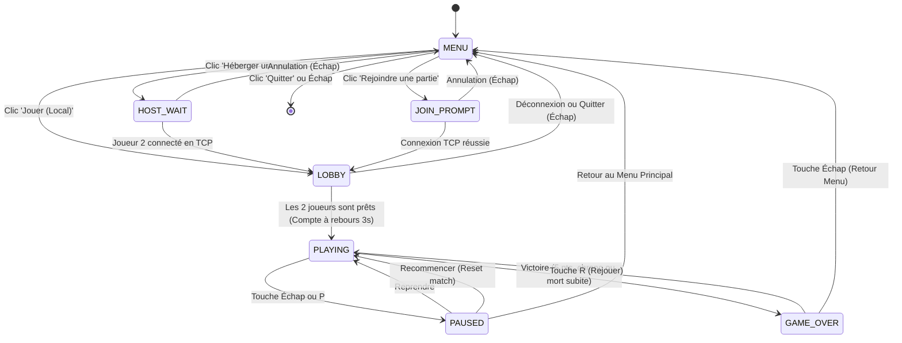
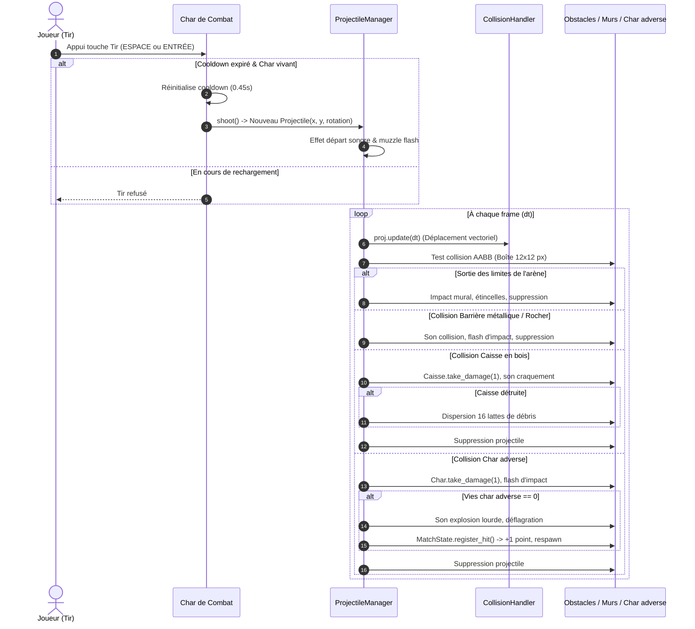

# 🏛️ Documentation Technique Complète — TANK WAR (Arena Duel)

> **Version** : 1.0.0  
> **Auteur** : Équipe de développement Arena Duel  
> **Technologies** : Python 3.12+ (compatible 3.14), Pygame-ce 2.5+, Sockets TCP, Multithreading, JSON, Pytest 8.0+  
> **Architecture** : Modulaire inspirée de Clean Architecture & Modèle Serveur Autoritaire  

---

## 1. Vue d'Ensemble & Architecture Globale

**Tank War (Arena Duel)** est un jeu de combat de chars d'assaut en 2D, vue du dessus (*Top-Down*), conçu pour deux joueurs s'affrontant soit sur le même ordinateur, soit à travers un réseau local Wi-Fi (LAN) sans aucune dépendance à Internet.

Le projet applique une séparation stricte des responsabilités (inspirée des principes SOLID et de Clean Architecture) :
- **Séparation Domaine / Rendu** : Le moteur logique (`game/`, `players/`) calcule les grandeurs physiques en unités indépendantes des pixels, tandis que les modules d'affichage (`interface/`, `game/asset_manager.py`) assurent la projection visuelle à 60 FPS.
- **Serveur Autoritaire** : Lors d'une partie en réseau, l'hôte (PC 1) exécute la simulation physique officielle, résout les collisions continues (CCD), comptabilise les dégâts et diffuse l'état officiel. Le client (PC 2) ne prend aucune décision d'arbitrage : il transmet ses commandes clavier brutes et affiche les instantanés validés.

### 1.1 Diagramme de l'Architecture Globale du Projet

```mermaid
flowchart TD
    subgraph UI_Layer ["Couche Interface Utilisateur (interface/)"]
        App["GameApp (Machine à États)"]
        Menu["MainMenu (Accueil)"]
        HostUI["HostScreen (Attente LAN)"]
        JoinUI["JoinScreen (Saisie IP Asynchrone)"]
        LobbyUI["LobbyScreen (Salon & Compte à Rebours)"]
        HUDUI["HUD (Vies, Chrono, Scores)"]
        PauseUI["PauseOverlay (Menu Pause)"]
        GameOverUI["GameOverOverlay (Résultats & Rejouer)"]
    end

    subgraph Core_Game ["Couche Logique & Physique (game/ & players/)"]
        Tanks["Tank (P1 Rouge & P2 Vert)"]
        Controls["TankControls (Entrées Clavier)"]
        ColHandler["CollisionHandler (CCD Anti-Tunneling)"]
        ProjMgr["ProjectileManager (Balistique & Tirs)"]
        ArenaMap["ArenaMap (Sol, Murs & Obstacles)"]
        GameState["MatchState (Arbitre : 3 Vies, Score à 5, Chrono 90s)"]
        PowerMgr["PowerUpManager (Bouclier, Vitesse, Tir Rapide)"]
    end

    subgraph Media_Layer ["Couche Audiovisuelle & Cache (game/)"]
        AssetMgr["AssetManager (Textures & Rotations Mises en Cache)"]
        SoundMgr["SoundManager (Synthèse WAV & Mixage Stéréo)"]
        EffectsMgr["EffectsManager (Explosions, Étincelles, Confettis)"]
    end

    subgraph Network_Layer ["Couche Réseau TCP (network/)"]
        NetServer["NetworkServer (Hôte Autoritaire 30 Hz)"]
        NetClient["NetworkClient (Client Non-Bloquant)"]
        NetConn["NetworkConnection (Socket TCP, TCP_NODELAY, Framing \\n)"]
        NetProtocol["NetworkProtocol (Sérialisation & Schémas JSON)"]
    end

    App --> Menu
    App --> HostUI
    App --> JoinUI
    App --> LobbyUI
    App --> HUDUI
    App --> PauseUI
    App --> GameOverUI

    App --> Tanks
    App --> ArenaMap
    App --> ProjMgr
    App --> GameState
    App --> PowerMgr

    Tanks --> Controls
    Tanks --> ColHandler
    Tanks --> ProjMgr
    ProjMgr --> ColHandler

    App --> AssetMgr
    App --> SoundMgr
    App --> EffectsMgr

    App -. Mode Hôte .-> NetServer
    App -. Mode Client .-> NetClient
    NetServer --> NetConn
    NetClient --> NetConn
    NetServer --> NetProtocol
    NetClient --> NetProtocol
```



---

## 2. Arborescence Détaillée et Rôle des Fichiers

```text
Tank war/
├── main.py                     # Point d'entrée principal, boucle 60 FPS et machine à états GameApp
├── settings.py                 # Constantes globales, dimensions, vitesses, couleurs et chemins
├── generate_assets.py          # Générateur procédural des textures PNG cartoon transparentes
├── requirements.txt            # Spécification des dépendances Python (pygame-ce, pytest)
├── README.md                   # Présentation rapide, installation et démarrage
│
├── assets/                     # Ressources graphiques et sonores
│   ├── icons/                  # 28 icônes cartoon transparentes 32-bit (menu/, network/, hud/, pause/, results/)
│   ├── maps/                   # desert_background.png, border_tile.png
│   ├── obstacles/              # crate.png, barrier_horizontal.png, rock_large.png, plant_cactus.png...
│   ├── powerups/               # shield.png, speed.png, rapid_fire.png
│   ├── projectiles/            # bullet.png
│   ├── sounds/                 # shoot.wav, explosion.wav, collision.wav, crate_break.wav...
│   ├── sprites/                # Miroirs de repli pour textures haute compatibilité
│   └── tanks/                  # tank_red.png, tank_green.png
│
├── docs/                       # Documentation technique approfondie
│   ├── PROJECT_DOCUMENTATION.md# Ce document (architecture, classes, logique)
│   ├── USER_GUIDE.md           # Guide utilisateur et prise en main du jeu
│   ├── NETWORK_GUIDE.md        # Tutoriel pas-à-pas multijoueur LAN Wi-Fi
│   └── FAQ.md                  # Dépannage et questions fréquentes
│
├── game/                       # Logique métier, moteur physique et effets
│   ├── __init__.py
│   ├── asset_manager.py        # Singleton de cache mémoire d'images et surfaces pré-pivotées
│   ├── collision.py            # CollisionHandler (résolution continue CCD et glissement mural)
│   ├── effects.py              # EffectsManager, explosions, particules d'impact et confettis
│   ├── game_state.py           # MatchState (arbitrage : 3 vies, score à 5, chrono 90s, mort subite)
│   ├── map.py                  # ArenaMap (découpage du décor, bordures, obstacles et caisses)
│   ├── obstacle.py             # Obstacle (bloquant/destructible), Decoration (non-bloquante), Debris
│   ├── powerup.py              # PowerUp et PowerUpManager (gestion des bonus au sol)
│   ├── projectile.py           # Projectile (obus balistique orienté)
│   ├── projectile_manager.py   # ProjectileManager (gestion des tirs, étincelles et résolution d'impacts)
│   └── sound_manager.py        # SoundManager (générateur audio procédural et contrôle du volume)
│
├── interface/                  # Composants et écrans graphiques
│   ├── __init__.py
│   ├── components.py           # UIButton avec icônes, UITextInput, UIPanel
│   ├── icon_manager.py         # IconManager (cache multi-niveaux, redimensionnement et gestion d'états)
│   ├── hud.py                  # Affichage tête haute (cœurs de vie, score, chrono, pips de recharge)
│   ├── lobby.py                # LobbyScreen (fiches joueurs, bouton Prêt et compte à rebours 3s)
│   ├── menu.py                 # MainMenu (logo animé, boutons Jouer, Héberger, Rejoindre, Quitter)
│   ├── scoreboard.py           # Écran de fin de match et bandeau d'alerte de Mort Subite
│   └── screens.py              # HostScreen, JoinScreen, PauseOverlay, GameOverOverlay
│
├── network/                    # Couche réseau multijoueur TCP autoritaire
│   ├── __init__.py
│   ├── client.py               # NetworkClient (connexion non-bloquante, échantillonnage à 30 Hz)
│   ├── connection.py           # NetworkConnection (socket TCP, TCP_NODELAY, thread daemon, framing \n)
│   ├── protocol.py             # NetworkProtocol, énumération MessageType et schéma JSON standardisé
│   └── server.py               # NetworkServer (détection IP LAN, autorité 30 Hz, rejet du 3e joueur)
│
├── players/                    # Modélisation des chars et entrées joueurs
│   ├── __init__.py
│   ├── controls.py             # TankControls (mappage ZQSD / Flèches et requêtes de tir)
│   └── tank.py                 # Tank (hitbox, vies, vitesses, tourelle, canon, rotation et bouclier)
│
└── tests/                      # Suite de 80 tests automatisés Pytest
    ├── test_audio_visuals.py   # Validation de l'AssetManager, SoundManager et EffectsManager
    ├── test_collisions_advanced.py # Anti-tunneling CCD, barrières métalliques, caisses destructibles
    ├── test_combat.py          # Tirs simultanés, cooldowns balistiques, dégâts et portée
    ├── test_config.py          # Cohérence des constantes globales de settings.py
    ├── test_icon_manager.py    # Tests IconManager, redimensionnement, états visuels et boutons
    ├── test_map.py             # Dimensions arène, spawns inoccupés, obstacles physiques
    ├── test_models.py          # Modèles mathématiques vectoriels et sérialisation
    ├── test_network.py         # Framing \n, handshake, diffusion 30 Hz, déconnexion/reconnexion
    ├── test_progression.py     # 3 vies, score à 5, chrono 90s, mort subite, bonus actifs
    ├── test_protocol.py        # Sérialisation et désérialisation JSON
    ├── test_tank.py            # Normalisation 8 directions, vitesse dt, collisions entre chars
    └── test_ui_screens.py      # Transitions, boutons interactifs, formulaire de saisie IP
```

---

## 3. Analyse des Classes Principales et Rôles Métier

### 3.1 [`players/tank.py`](file:///d:/sideproject/Tank%20war/players/tank.py) — Classe `Tank`
Représente un char de combat dans l'arène.
- **Propriétés clés** :
  - `position: pygame.Vector2` : Coordonnées cartésiennes sub-pixel réelles.
  - `direction: pygame.Vector2` : Vecteur directionnel normalisé ($\lVert \vec{d} \rVert \in \{0, 1\}$).
  - `rotation: float` : Angle absolu d'orientation du châssis et du canon en degrés ($0^\circ = \text{Est}$, $90^\circ = \text{Sud}$, $180^\circ = \text{Ouest}$, $270^\circ = \text{Nord}$).
  - `vie: int` / `max_vie: int` : Nombre de vies pour la manche en cours (défaut : 3).
  - `hitbox: pygame.Rect` : Boîte englobante centrée de $50 \times 50\text{ px}$ utilisée pour la détection des collisions physiques.
  - `current_cooldown: float` : Décompte du rechargement du canon ($0.45\text{ s}$ de base, $0.225\text{ s}$ sous bonus Tir Rapide).
  - `shield_timer`, `speed_timer`, `rapid_fire_timer`, `invulnerable_timer` : Minuteurs d'effets temporaires.
- **Méthodes clés** :
  - `move(dt, obstacles, bounds_rect, other_tank_rect)` : Déplace le char en invoquant `CollisionHandler.move_and_slide`.
  - `get_cannon_tip_position() -> pygame.Vector2` : Calcule l'extrémité exacte du canon selon l'angle actuel ($x + 38 \cos(\theta), y + 38 \sin(\theta)$).
  - `shoot() -> Optional[Projectile]` : Instancie un obus si `current_cooldown <= 0.0`.
  - `take_damage(amount=1) -> bool` : Décrémente la vie si aucun bouclier n'est actif.

### 3.2 [`game/collision.py`](file:///d:/sideproject/Tank%20war/game/collision.py) — Classe `CollisionHandler`
Moteur de détection continue des collisions (*Continuous Collision Detection - CCD*).
- **Problème résolu** : À haute vitesse ou sous baisse momentanée de FPS, un déplacement classique en un seul saut risque de faire traverser un mur fin ou une barrière (effet de *tunneling*).
- **Solution implémentée** :
  1. Découpage du déplacement global en sous-pas élémentaires ne dépassant jamais $6.0\text{ px}$ (`SUB_STEP_SIZE`).
  2. Résolution axe par axe (Axe X puis Axe Y) permettant le **glissement naturel le long des parois** (*wall sliding*).
  3. Contrainte stricte à l'intérieur des bordures de l'arène (`bounds_rect.clamp_ip`).
  4. Séparation physique immédiate si les hitboxes des deux tanks se chevauchent.

### 3.3 [`game/projectile_manager.py`](file:///d:/sideproject/Tank%20war/game/projectile_manager.py) — Classe `ProjectileManager`
Supervise le cycle de vie balistique de l'ensemble des tirs.
- **Règles d'arbitrage** :
  - Un projectile ne peut **jamais** toucher son propriétaire (`proj.owner_id == tank.player_id` est ignoré).
  - Lorsqu'un obus heurte une barrière métallique ou un mur d'enceinte : il est détruit, génère un flash d'impact, une gerbe d'étincelles et joue le son `collision.wav`.
  - Lorsqu'un obus heurte une caisse en bois destructible : la caisse absorbe l'impact. Si ses PV tombent à 0, elle explose en dispersant 16 lattes de bois avec le son `crate_break.wav`.
  - Lorsqu'un obus heurte le tank adverse : il s'autodétruit, inflige les dégâts au char et avertit `MatchState`. Si la vie du char atteint 0, une grande déflagration `TankExplosionEffect` est déclenchée avec le son `explosion.wav`.

### 3.4 [`game/game_state.py`](file:///d:/sideproject/Tank%20war/game/game_state.py) — Classe `MatchState`
Arbitre central du match, totalement découplé de Pygame.
- **Gestion des Vies & Manches** : Chaque joueur possède 3 vies. Perdre ses 3 vies octroie 1 point à l'adversaire et active le drapeau `respawn_needed`.
- **Chronomètre de 90 secondes** : Décompte en temps réel.
- **Mort Subite** : Déclenchée si égalité stricte à l'expiration des 90 secondes. Le chrono se fige et la manche se poursuit jusqu'à la première élimination décisive.
- **Condition de Victoire** : Premier joueur à atteindre **5 points** (ou en tête à l'expiration du temps).

### 3.5 [`game/asset_manager.py`](file:///d:/sideproject/Tank%20war/game/asset_manager.py) — Classe `AssetManager`
Singleton de gestion et d'optimisation des ressources graphiques.
- Pré-charge toutes les textures en mémoire vidéo (`convert_alpha()`).
- Maintient un dictionnaire de surfaces pré-pivotées `(couleur, angle_deg) -> pygame.Surface` pour éliminer l'allocation et le recalcul trigonométrique à 60 FPS.

### 3.6 [`game/sound_manager.py`](file:///d:/sideproject/Tank%20war/game/sound_manager.py) — Classe `SoundManager`
Synthétiseur procédural et contrôleur de mixage audio.
- Génère 7 sons stéréo 16-bit 44.1 kHz PCM (`shoot.wav`, `explosion.wav`, `collision.wav`, `crate_break.wav`, `powerup.wav`, `victory.wav`, `defeat.wav`) sans aucune dépendance externe.
- Gère le volume global `set_volume()` et l'inhibition `toggle_mute()`.

---

## 4. Machine à États de l'Application ([`main.py`](file:///d:/sideproject/Tank%20war/main.py))

L'application est orchestrée par la classe `GameApp` selon une machine à états finis (`AppState`) :



---

## 5. Gestion des Événements et Entrées Clavier

1. **Événements Pygame (`pygame.event.get()`)** :
   - Dépouillés en tête de boucle principale.
   - Les événements matériels (`KEYDOWN`, `MOUSEMOTION`, `MOUSEBUTTONDOWN`) sont transmis exclusivement à l'écran actif de la machine à états.
2. **Entrées Continues (`pygame.key.get_pressed()`)** :
   - Utilisées en cours de combat (`AppState.PLAYING`) pour échantillonner l'état simultané des touches et permettre le déplacement fluide dans 8 directions sans répétition d'événements système.

---

## 6. Moteur Balistique : Cycle de Vie d'un Projectile



